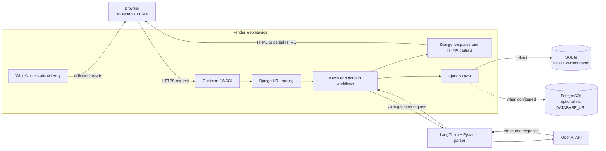
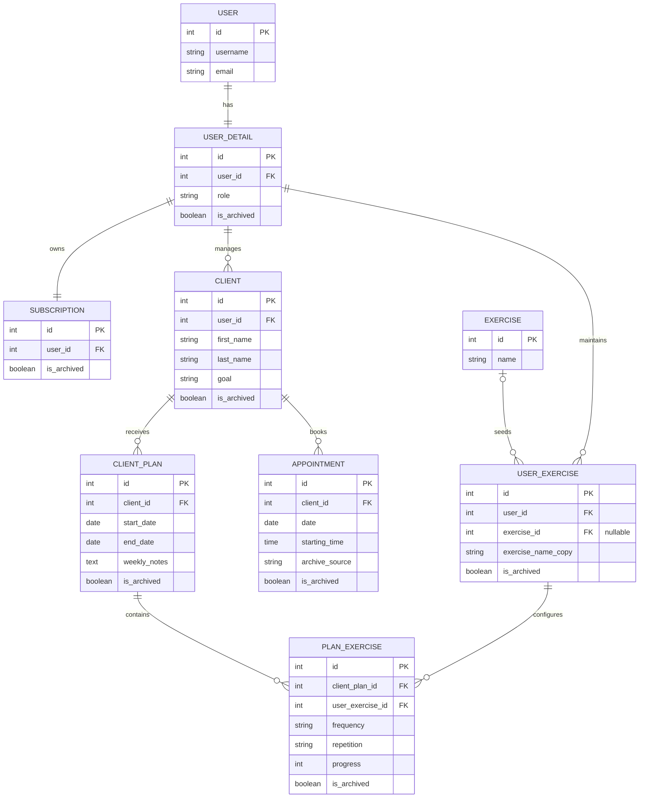

<div align="center">

# TrainForge

**A focused coaching workspace for personal trainers to manage clients, training plans, exercise progress, and weekly appointments.**

TrainForge combines server-rendered Django workflows with lightweight HTMX interactions and optional, trainer-reviewed AI suggestions.

[](https://trainforge-kg39.onrender.com)
[](https://github.com/Dennylunch/TrainForge/actions/workflows/ci.yml)
[](https://www.python.org/)
[](https://www.djangoproject.com/)
[](https://htmx.org/)
[](https://getbootstrap.com/)
[](https://openai.com/)
[](LICENSE)

[Live Demo](https://trainforge-kg39.onrender.com) · [Report a Bug](https://github.com/Dennylunch/TrainForge/issues/new?template=bug_report.yml) · [Request a Feature](https://github.com/Dennylunch/TrainForge/issues/new?template=feature_request.yml)

</div>

> [!IMPORTANT]
> The public demo runs on Render's free service with SQLite and no persistent disk. It is intended for evaluation only: accounts and data may reset after a restart, spin-down, or deployment. See [Render's free service documentation](https://render.com/docs/free).

## Project Overview

TrainForge is a server-rendered web application built for personal trainers who need one place to organise client records, configure exercise plans, monitor progress, and review upcoming appointments. Each authenticated trainer works with their own clients and exercise catalogue.

The application also provides two optional AI-assisted workflows: draft weekly training notes and suggested details for exercises the trainer has already selected. Generated content is presented for review and is never a substitute for professional or medical judgement.

## Key Features

### Client and plan management

- Create, search, edit, paginate, and soft-delete client profiles.
- Record goals, plan dates, selected exercises, weight information, and trainer notes.
- Configure frequency, repetitions, descriptions, and trainer-entered progress for each exercise.
- Derive plan status and elapsed-time progress from its start and end dates.

### Exercise catalogue

- Seed new trainer accounts with a default exercise collection.
- Add and rename trainer-specific exercises.
- Prevent an exercise from being removed while an active plan still uses it.

### Scheduling and history

- Schedule one active one-hour appointment per client.
- Navigate a Monday-to-Sunday calendar with hourly slots from 08:00 to 20:00.
- Display multiple clients within the same time slot.
- Preserve automatically archived appointment history while keeping manually removed appointments hidden.

### AI-assisted drafting

- Generate three structured weekly-note alternatives and select one through an HTMX partial update.
- Suggest frequency, repetitions, and descriptions for exercises already chosen by the trainer.
- Keep the trainer in control: suggestions are reviewed before they are selected or saved.
- Fall back to the existing form state when generation fails.

### Authentication and data isolation

- Use Django session authentication, CSRF protection, password hashing, and password validators.
- Scope protected client, plan, exercise, and appointment lookups to the authenticated trainer.
- Use confirmation pages and POST requests for destructive user actions.

## Technology Stack

| Area | Technologies | Role |
| --- | --- | --- |
| Backend | Python 3.14, Django 6.0.3, Gunicorn | Routing, business logic, authentication, and server-rendered responses |
| Frontend | Django Templates, Bootstrap 5.3.8, Bootstrap Icons, HTMX 2.0.8 | Responsive UI and targeted partial-page updates |
| Database | SQLite; `dj-database-url`; PostgreSQL driver | SQLite is the default and current demo database; `DATABASE_URL` enables a URL-configured database |
| AI / APIs | OpenAI API, LangChain, Pydantic | Structured, trainer-reviewed draft suggestions |
| Deployment | Render, WhiteNoise | Hosted WSGI service and compressed static-file delivery |
| Development tools | Django TestCase, Git, GitHub Actions | Automated checks, tests, and collaboration workflow |

## System Architecture

TrainForge uses a Django monolith: browser requests, templates, application logic, and persistence remain in one deployable service. HTMX adds small interactive islands without requiring a separate JavaScript build pipeline.



## Database Design

The schema extends Django's built-in user model with trainer-specific records. Soft-archive fields preserve selected business history, while foreign keys enforce ownership and cascade related data when a parent is physically removed.



## Screenshots

Product screenshots are being prepared with fictional client data. The repository intentionally does not use stock illustrations as substitutes for the real interface.

| View | What the capture will demonstrate | Status |
| --- | --- | --- |
| Client dashboard | Search, client summaries, plans, notes, and progress | Capture needed |
| Plan customisation | Exercise fields and trainer-reviewed AI suggestions | Capture needed |
| Weekly schedule | Week navigation, appointment slots, and archived history | Capture needed |

## Installation Guide

### Prerequisites

- Python 3.14
- Git
- An OpenAI API key only if you want to use AI-assisted suggestions

### 1. Clone the repository

```bash
git clone https://github.com/Dennylunch/TrainForge.git
cd TrainForge
```

### 2. Create and activate a virtual environment

macOS or Linux:

```bash
python3 -m venv .venv
source .venv/bin/activate
```

Windows PowerShell:

```powershell
py -3.14 -m venv .venv
.\.venv\Scripts\Activate.ps1
```

### 3. Install dependencies

```bash
python -m pip install --upgrade pip
python -m pip install -r requirements.txt
```

### 4. Configure the environment

macOS or Linux:

```bash
cp .env.example .env
```

Windows PowerShell:

```powershell
Copy-Item .env.example .env
```

Replace the example `SECRET_KEY` and add `OPENAI_API_KEY` if required.

### 5. Prepare the database

```bash
python manage.py migrate
```

The migrations create the schema and seed the default exercises that are copied into each new trainer's catalogue at signup.

### 6. Start the application

```bash
python manage.py runserver
```

Open <http://127.0.0.1:8000/>. The authenticated application is mounted under `/trainforge/`.

## Local Development

Run Django's configuration checks and automated tests before opening a pull request:

```bash
python manage.py check
python manage.py makemigrations --check --dry-run
python manage.py test
```

To verify the production static-file pipeline locally:

```bash
python manage.py collectstatic --noinput
```

Collected files are generated in `staticfiles/` and are intentionally excluded from version control.

## Environment Variables

| Variable | Requirement | Purpose |
| --- | --- | --- |
| `SECRET_KEY` | Required | Signs Django sessions and security-sensitive values. Use a unique, private value. |
| `DEBUG` | Optional | Enables Django debug mode. Defaults to `True`; set to `False` for hosted environments. |
| `OPENAI_API_KEY` | Optional | Required only when invoking AI-assisted suggestion features. |
| `DATABASE_URL` | Optional | Switches persistence from the SQLite fallback to a URL-configured database. |
| `CSRF_TRUSTED_ORIGINS` | Optional | Comma-separated HTTPS origins trusted for CSRF-protected requests. |
| `RENDER_EXTERNAL_HOSTNAME` | Platform-managed | Added to `ALLOWED_HOSTS` automatically when Render provides it. |

Never commit `.env`, database files, or API credentials.

## Project Structure

```text
TrainForge/
├── .github/                  # CI, issue forms, and pull request template
├── trainforge/               # Django project settings, routing, ASGI, and WSGI
├── trainforgeapp/            # Models, forms, views, migrations, tests, and templates
│   ├── migrations/           # Schema history and default exercise seed
│   ├── templates/            # Pages and HTMX partials
│   ├── models.py             # Domain and persistence model
│   ├── views.py              # Trainer workflows and AI integrations
│   └── tests.py              # Django application tests
├── .env.example              # Safe local configuration template
├── manage.py                 # Django management entry point
└── requirements.txt          # Pinned Python dependencies
```

## Design Decisions

- **Server-rendered monolith:** Django templates keep routing, validation, rendering, and persistence cohesive for the project's scope.
- **Targeted HTMX interactions:** AI note selection updates only the affected section without introducing a separate SPA or frontend build system.
- **Trainer-scoped queries:** protected object lookups include the authenticated trainer, reducing accidental cross-account data access.
- **Soft archival with provenance:** appointment archive sources distinguish elapsed history from explicit user deletion.
- **Human-reviewed AI:** structured output is shown as editable or selectable draft content before persistence.
- **Portable persistence:** SQLite keeps local setup small, while `DATABASE_URL` allows a hosted database configuration.

## Challenges and Solutions

| Engineering challenge | Implemented solution |
| --- | --- |
| Preserve useful appointment history without resurfacing deleted entries | Track automatic, manual, and legacy archive sources and show only automatic history |
| Keep client summaries efficient as related appointments grow | Prefetch ordered appointments and use `select_related` in the calendar query |
| Safely integrate non-deterministic model output | Parse structured JSON with Pydantic, keep a trainer review step, and fall back without overwriting saved data |
| Give each trainer a customisable exercise catalogue | Seed canonical exercises through a migration, then copy them into trainer-owned records at signup |
| Support development and hosted execution with one settings module | Use SQLite by default, optional `DATABASE_URL`, Gunicorn, Render host discovery, and WhiteNoise |

## Current Limitations

- The public demo's SQLite database is ephemeral and should not be used for durable or sensitive data.
- AI suggestions require an OpenAI API key and do not include medical or safety validation.
- One-active-appointment and date-ordering rules are enforced primarily in view logic rather than database constraints.
- Automated coverage currently focuses on appointment lifecycle, calendar behaviour, ownership isolation, and legal pages.

## Roadmap

- [ ] Move hosted persistence to PostgreSQL or a persistent disk.
- [ ] Expand authentication, CRUD, validation, ownership, and AI failure-path tests.
- [ ] Add date-ordering and uniqueness constraints where the product rules require them.
- [ ] Add explicit AI endpoint methods, timeouts, structured logging, and usage controls.
- [ ] Add first-party screenshots, accessibility checks, and browser-level tests.

## Contributing

Contributions and focused improvement proposals are welcome. Read [CONTRIBUTING.md](CONTRIBUTING.md) before opening an issue or pull request. For security-sensitive reports, follow [SECURITY.md](SECURITY.md).

## License

TrainForge is available under the [MIT License](LICENSE).

## Author

**Lanzhi Zhang** — [@Dennylunch](https://github.com/Dennylunch)
